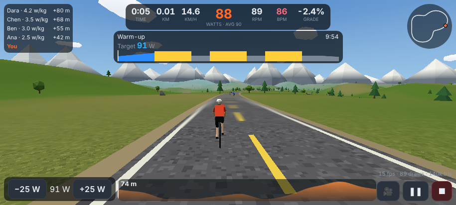

# FreeBike

A lightweight, **fully offline** indoor cycling app in the spirit of Zwift: ride a
low-poly 3D world with your smart trainer, power meter, cadence sensor and heart-rate
strap. The graphics aim for PS2-era quality so it runs smoothly on ordinary Android phones and tablets.



## Features

- **Bluetooth LE sensors** using standard profiles, so **Magene** gear works
  (T300 / T110 trainers, P505 / PES power meters, S3+ speed/cadence, H64 / H303 HR)
  along with Wahoo, Tacx, Elite, Saris, JetBlack, Garmin, Stages, Favero and others:
  - **FTMS** (0x1826): smart trainer power, cadence, speed, plus **ERG** and **SIM** control
  - **Cycling Power** (0x1818): power meters, and older trainers that don't do FTMS
  - **CSC** (0x1816): speed / cadence sensors
  - **Heart Rate** (0x180D)
  - Pair several at once. Dedicated sensors beat trainer-reported values
    (power meter > trainer power, etc.). Dropped connections reconnect automatically.
- **SIM mode**: the trainer gets the road gradient, scaled by an adjustable *trainer difficulty*.
- **ERG workouts**: Sweet Spot, VO2max, Endurance and a Ramp test, all relative to your FTP.
- **Realistic virtual speed** from power, weight, grade, rolling resistance and aero drag, with **drafting**.
- **Pacer bots** at 2.5 to 4.2 W/kg to ride with.
- **3 procedurally generated routes** (flat to alpine) with hills, lakes, forests, hamlets,
  snowy mountains, start/finish and KOM arches. They're generated from a seed, so the app ships no world assets.
- HUD with power (3 s avg), avg power, cadence, HR, speed, distance, grade, elevation profile, minimap and rider standings.
- 4 camera views (chase, high chase, side, first-person).
- **Ride history**, plus **TCX export** for Strava, Garmin Connect, intervals.icu and TrainingPeaks.
- **Simulator mode** for trying it without hardware (arrow keys or on-screen ±25 W).
- Installable **PWA** that works completely offline after the first load. It keeps the screen awake while you ride.

## Graphics / performance

The "PS2" preset renders at about 448 lines and upscales with nearest-neighbour filtering,
using tiny procedural textures, vertex colours, flat-shaded Lambert materials and linear fog.
A typical frame is about 60–80 draw calls and about 140k triangles:

- terrain is split into chunks so frustum culling skips what isn't in view
- trees and rocks are `InstancedMesh` (one draw call per type)
- each rider is baked into about 10 meshes
- houses, mountains and clouds are merged into single meshes

| Preset | Resolution | Use |
| ------ | ---------- | --- |
| PS2 (default) | 448p | most phones/tablets |
| Low | 360p, fewer trees, shorter fog | old / low-end Android |
| High | native res (≤2× DPR), more trees | desktops, flagship tablets |

## Running

```bash
npm install
npm run dev        # http://localhost:5173 (also exposed on your LAN)
npm test           # parser / physics / workout / recorder tests
npm run build      # production build in dist/ (includes offline service worker)
npm run preview
```

### On Android

Web Bluetooth needs **Chrome on Android** and an **HTTPS** origin (or `localhost`).

1. Host the `dist/` folder on any HTTPS static host. The included GitHub Actions
   workflow (`.github/workflows/pages.yml`) deploys to GitHub Pages on every push to `main`.
   Enable it under *Settings → Pages → Source: GitHub Actions*.
2. Open the URL in Chrome on the phone, then use **⋮ → Add to Home screen / Install app**.
3. After that it launches full-screen and runs with no internet connection.

For local testing on a phone without hosting, use `chrome://inspect` port forwarding
so the phone loads it as `localhost:5173`.

iOS Safari has no Web Bluetooth. Use the *Bluefy* browser, or wrap the app natively (see below).

## Project layout

```
src/
  ble/parsers.ts    pure FTMS / CPS / CSC / HR parsers + FTMS command encoders (unit tested)
  ble/devices.ts    Web Bluetooth pairing, reconnect, data merging, ERG / SIM control
  sim/physics.ts    power -> speed model
  world/route.ts    seeded closed-loop route generator (centre line + elevation)
  world/world.ts    terrain, road, water, trees, rocks, mountains, arches, houses, clouds
  world/rider.ts    low-poly cyclist with IK pedalling legs
  world/textures.ts tiny procedural canvas textures
  game.ts           renderer, riders/bots, drafting, cameras, quality presets
  workouts.ts       structured workouts
  recorder.ts       1 Hz recording, NP, history, TCX export
  ui/hud.ts         minimap, elevation profile, workout chart
  main.ts           menu, ride loop, HUD wiring
```

## Roadmap ideas

- Native Android/iOS wrapper (Capacitor + `@capacitor-community/bluetooth-le`) for Play Store
  distribution and iOS BLE support. The BLE layer is isolated in `src/ble/` to make this swap easy.
- FIT file export; ANT+ (via native wrapper)
- Magene proprietary-protocol fallback for older non-FTMS trainers
- Route editor / GPX import, more biomes, day/night cycle
- Optional online group rides later
